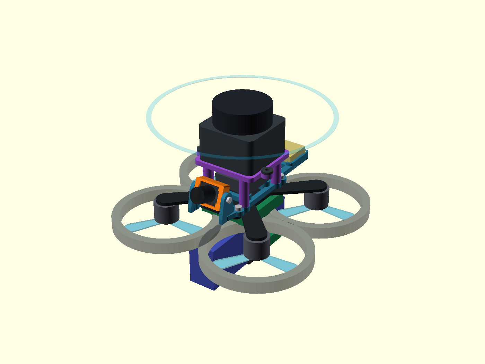

# Pavo20 Pro + Walksnail Ascent Lite+ + odnímatelný D500

Kompletní parametrická sestava v **[pavo20_pro_assembly.scad](pavo20_pro_assembly.scad)**.
Model ukazuje celý dron, kameru s uchycením, VTX, anténu a volitelný
horní modul pro **D500 / STL-19P**. Původní soubor
`pavo20_pro_walksnail_lite_plus.scad` také otevírá tuto sestavu.

**Aktuální revize:** GPS má vlastní zadní vaničku a most má rozteč
26 × 34 mm s vůlí pro hlavy rámových šroubů. Použij novou `1-base.stl`
i `3-d500_module.stl` společně; stará rozteč 26 × 36 mm není kompatibilní.
[Kontrola po opravě](KONTROLA_MODELU.md) · [nový výpočet vyvážení](VYVAZENI.md).

**Je to konstrukční prototyp.** Tiskové díly mají ověřenou geometrii;
usazení na skutečném rámu, pevnost a vibrace nebyly fyzicky ověřeny.
Ducty, karbon, motory a elektronika jsou zjednodušené referenční obálky,
ne výrobní modely náhradních letových dílů.



## Kde je uchycení

- **Kamera:** oranžová TPU objímka se zasouvacími rohovými zarážkami.
  Dva boční šrouby M2 ji upevňují mezi skutečné přední bočnice základny.
  Povolením šroubů se nastaví náklon. Výchozí úhel je 20°.
- **Anténa Lite+:** zadní rozříznutá objímka s podélnou štěrbinou pro kabel
  a obvodovou drážkou pro 2,5mm stahovací pásek. Navržený otvor je 3,2 mm;
  přeměř průměr pevné části antény. Anténu zasunuj od konce, tuhou objímku
  neroztahuj násilím; pásek drží plášť, nikoliv IPEX konektor.
- **VTX:** čtyři sloupky s průchozími otvory, rozteč 20 × 20 mm.
- **GPS WS-M181:** zadní vanička pro 18 × 18 × 4,6 mm, s 0,4mm vůlí
  na každé straně. Nalep modul na **1mm nevodivou oboustrannou podložku**,
  keramickou anténou nahoru. Nízký lem omezuje boční pohyb, podložka drží
  modul svisle. Přední 14mm výřez uvolňuje konektor; vodič veď podél
  bočního ramena a odlehči jej. Ověř konektor a spolehlivost lepení na kusu.
- **Rám:** čtyři oka, rozteč 26 × 45,6 mm. Plochá základna tloušťky
  3,2 mm sedí přímo na horním karbonu. Motory, vrtule a FC jsou pod ním;
  původní chybné 18mm vyvýšení bylo odstraněné.
- **D500:** samostatný horní most na čtyřech M2 šroubech. Senzor se na most
  upevní třemi dalšími šrouby přes vlastní montážní patky. Při sejmutí
  mostu zůstane kamera, VTX i anténa na místě. USB převodník z D500 kitu
  patří na stůl, v letové sestavě není.

[Držák zepředu](holder_front.png) · [držák zezadu s úchytem antény](holder_rear.png)
· [dron bez D500](drone_without_d500.png) · [boční pohled](drone_side.png)

## OpenSCAD a tiskové soubory

Otevři hlavní `pavo20_pro_assembly.scad`; v Customizeru jsou také předvolby
ze stejnojmenného JSON. Výchozí `part="drone"` zobrazuje celý dron.
`lidar_enabled=false` zobrazí variantu bez lidaru a bez jeho horního mostu.
`battery_variant="750"` nebo `"550"` vybírá skutečně koupený pack.

| Soubor / parametr | Účel |
| --- | --- |
| [1-base.stl](1-base.stl), `part="base"` | Společná základna, kamera/VTX/anténa/GPS a rozhraní pro D500. |
| [2-camera_insert.stl](2-camera_insert.stl), `part="insert"` | TPU objímka Lite+. |
| [3-d500_module.stl](3-d500_module.stl), `part="lidar"` | Odnímatelný horní most; STL je otočené pro tisk. |
| `part="assembly"` | Sestava držáku, referenční elektronika jen v F5. |
| `part="print"` | Tiskové díly vedle sebe; mají různé doporučené materiály. |
| `camera_insert.scad` | Knihovna parametrů a geometrie objímky, nutná vedle hlavního SCAD. |
| `print_mass_properties.scad` | Generované objemy a těžiště STL, také nutné vedle hlavního SCAD. |
| `refresh_model.py` | Export dílů, přepočet vyvážení a kontrola kolizí jedním příkazem. |
| `README_adapter_v1.md`, `archiv/` | Archiv první samostatné vložky 19/20 mm. |

Pro novou základnu použij **20mm vložku** (`2-camera_insert.stl`), nikoliv
archivní 19mm variantu. Celý dron se netiskne jako jeden díl. Pro export
vždy vyber `base`, `insert` nebo `lidar`, proveď F6 a export STL.

Základna a most jsou navržené jako **tuhé díly**; výchozí tiskový návrh je
PETG, 0,2mm vrstva, alespoň 4 perimetry. Objímka kamery je **TPU 95A**.
Základnu tiskni plochou spodní stranou dolů; zvýšená paluba ani její
podpory už nejsou potřeba. Přemostění kapes pro hlavy a matice ověř ve sliceru;
most je ve STL již obrácený horní deskou dolů. Objímka leží přední
stranou dolů a má jen malé přesahy zarážek. Tiskové profily ani mechanická
odolnost nejsou odzkoušené. Pro 47g lidar nepovažuj měkkou TPU věž za
náhradu tuhého mostu bez ověření vibrací.

## Montážní materiál

- 4× M2 pro oka do rámu; délka závisí na skutečné desce/maticích rámu.
  Prostor je kontrolovaný pro hlavy Ø4,2 × 2 mm; vůle k mostu je 0,5 mm.
- 2× M2 pro kameru: bočnice 2,4 mm + mezera 0,1 mm + nejvýše **1,5 mm**
  záběru do TPU. Výchozí kandidát je M2×4; délku skutečně zkontroluj.
- 4× M2 s maticemi pro VTX; délku zvol podle patek VTX. Šrouby se vkládají
  zespodu před montáží základny. Kapsy Ø4,2 × 1,6 mm vyžadují nízké hlavy,
  které nesmějí vyčnívat pod základnu. Otvory ve sloupcích jsou průchozí.
- 4× M2 pro připojení mostu **shora**, návrhově **23 mm** pod hlavou
  (např. upravené M2×25). Při dosednutí hlavy na z=23,4 mm končí 23mm
  šroub na z=0,4 mm. Použij nízké hlavy do kapes Ø4,2 × 1,6 mm.
  Čtyři matice jsou zachycené ve spodku základny, kapsy mají 4,2 mm přes
  plochy a hloubku 1,8 mm. Přeměř skutečné hlavy, matice i délky;
  šroub nesmí vyčnívat do karbonu a hlava nesmí tlačit do senzoru.
- 3× M2 s podložkami a maticemi pro vlastní patky D500; délku odvoď z
  3mm platformy a skutečné tloušťky patky. Model nedělá závit do senzoru.
- Stahovací pásek 2,5 mm pro anténu a odlehčení kabelu.

Nejdřív vlož do spodku základny matice mostu a šrouby VTX, pak základnu
připevni na karbon. Osaď VTX, přišroubuj most shora a nakonec senzor.
Pro sejmutí mostu odpoj kabel a nejprve sundej senzor, který zakrývá hlavy
čtyř šroubů mostu. Kamera, VTX i anténa zůstávají na základně. Netahej za kabel.
Poloha kabelu je pod rotující optickou částí.

## Rozměry a zbývající měření

Výkres výrobce Pavo20 Pro potvrzuje montážní středy **26 × 45,6 mm**.
Průměr a způsob použití původních silentbloků z něj ale nebyl převzat:
model předpokládá přímé M2 upevnění s otvory 2,3 mm. Výšky rámu, vrtulí,
stlačených silentbloků a volný prostor pro matice je nutné zkontrolovat.

U Lite+ zůstává neověřená tloušťka obdélníkového těla **`body_depth=4.5`**
a přiřazení šířky/výšky 14/12 mm z publikovaných 12 × 14 × 15,8 mm.
Přeměř tělo bez objektivu, rohové zarážky nesmějí tlačit na součástky ani
zakrývat mikrofon. Průměr 3 mm pro anténu je také návrhový odhad.

D500 byl opraven podle **datasheetu STL-19P v1.0, strana 7**:
54 × 46,29 × 35 mm včetně patek, tělo 38,59 mm, tři otvory Ø2,5 mm.
Starší projektové rozměry 38,59 × 38,89 × 33,5 mm nezahrnovaly stejnou
montážní obálku. Dvojice otvorů má rozteč 46,8 mm a třetí leží 31,92 mm
za jejich řadou. Souřadnice v modelu jsou odvozené z kót, ne odhadnuté
z fotografie. Přesto porovnej revizi svého D500 s výkresem.

**Z=0 je horní plocha karbonu**, karbon sahá do z=−2 mm. FC MicoAir
36 × 36 × 8 mm je pod deskou, od z=−11 do −3 mm. Motory visí směrem dolů
a modelovaná rovina vrtulí je z=−15,5 mm. RX leží od z=−15 do −12 mm;
baterie začíná horní stranou na z=−18 mm, aby neprotínala FC ani RX.
Orientace odpovídá fotografii výrobce; konkrétní výšky motorů, silentbloků,
RX a baterie jsou návrhové odhady, které je nutné přeměřit.
Výkres rámu dává odstup horního karbonu od horní hrany ductu přibližně
27,3−16,9 = 10,4 mm. Samotná výška modelovaného prstence 7,5 mm je odhad.
Starší `cad_pavo20` má chybné uspořádání nad deskou a nebyl tímto opraven.
GPS má vaničku jako součást základny; v modelu leží na `[0,49,6.5]` mm.
RX a MTF-02P zůstávají referenčními obálkami s návrhovými polohami;
jejich samostatné držáky nejsou součástí těchto tří STL.

## Vyvážení a ověření

Podrobný rozpočet, výsledky pro oba packy a postup vážení jsou v
**[VYVAZENI.md](VYVAZENI.md)**. Model neprohlašuje ideální letové vlastnosti:
minimalizuje podélný moment přidaného lidaru, zatímco výška těžiště,
setrvačnost a vibrace zůstávají omezeními reálné sestavy.

- Všechny tři STL: jeden souvislý uzavřený povrch, konzistentní orientace,
  každou hranu sdílejí dva trojúhelníky. Výstup: `mesh_report.json`.
- `check_clearances.scad`: prázdné průniky držáku s plnými disky vrtulí,
  základny s karbonem/FC/vložkou, vložky s karbonem, FC s karbonem/RX/baterií,
  RX s baterií, spodní elektroniky a baterie s vrtulemi a mostu s VTX.
  Ověřeno pro obě baterie, s lidarem i bez něj a náklony kamery 0/20/40°.
  Dosednutí základny na karbon toleruje 0,02 mm povrchu karbonu.
- Kontrola nezahrnuje přesné tovární ducty, konektory, deformaci výtisku,
  všechny šrouby nebo vodiče. Nenahrazuje montáž nasucho.
- Opravená kontrola zahrnuje navíc GPS, vyhrazenou obálku konektoru
  12 × 4 × 3 mm a hlavy rámových šroubů s 0,4mm radiální rezervou.
  Čtyři samostatné kontroly testují také skutečné STL; návrat původní
  polohy GPS nebo rozteče mostu musí vyvolat kolizi.

Po změně výchozích parametrů geometrie použij tento společný přepočet,
aby rozměry STL i jejich hmotnosti a těžiště zůstaly synchronizované:

```sh
python3 refresh_model.py
```

Samotný export v OpenSCAD neaktualizuje uložené objemové vlastnosti.
Změny přes Customizer platí pro aktuální náhled/export; pro hromadný
přepočet nastav hodnoty ve zdrojovém SCAD. Hmotnosti dílů lze po zvážení
zadat pomocí `base_measured_mass`, `insert_measured_mass`
a `lidar_mount_measured_mass`. Nula zachovává odhad podle objemu a hustoty.

```sh
openscad --export-format asciistl -D 'part="base"' -o 1-base.stl pavo20_pro_assembly.scad
openscad --export-format asciistl -D 'part="insert"' -o 2-camera_insert.stl pavo20_pro_assembly.scad
openscad --export-format asciistl -D 'part="lidar"' -o 3-d500_module.stl pavo20_pro_assembly.scad
python3 check_meshes.py
openscad -D 'part="check"' -o /tmp/pavo-clearances.stl check_clearances.scad
```

Poslední příkaz má skončit hláškou `Current top level object is empty.`
(OpenSCAD pro tento úspěšně prázdný průnik vrací kód 1.) Náhledy obnoví
`bash render.sh`; bez displeje `QT_QPA_PLATFORM=offscreen bash render.sh`.

## Podklady

- [Projekt: nakoupené součástky a skutečné baterie](../spec/realna_stavba_dronu/13_nakoupeno.md).
- [Projekt: kusovník a požadovaná věž](../spec/realna_stavba_dronu/11_kusovnik_pavo20.md).
- [Projekt: D500 už je doma](../spec/realna_stavba_dronu/15_test_linky_skenu.md), [lidar README](../lidar/README.md).
- [Původní obálková studie Pavo20](../cad_pavo20/drone.scad).
- [BETAFPV: výkres O3 držáku Pavo20 Pro](https://cdn.shopify.com/s/files/1/1778/6615/files/O3_Air_Unit_Bracket_diagram.jpg?v=1742891989).
- [BETAFPV: boční výkres rámu](https://cdn.shopify.com/s/files/1/1778/6615/files/Pavo20_Pro_Frame_diagram_with_O3.jpg?v=1742891989), [fotografie motorů pod karbonem](https://betafpv.com/cdn/shop/files/Pavo20_Pro_with_O3_bracket_1600x.jpg?v=1744878009).
- [CADDX: Ascent Lite+](https://www.caddxfpv.com/products/walksnail-ascent-hd-lite-plus-kit).
- [CADDX: GPS WS-M181, rozměry 18 × 18 × 4,6 mm](https://www.caddxfpv.com/products/walksnail-ws-m181gps).
- [LDROBOT: STL-19P datasheet v1.0, zejména str. 6–7](https://files.waveshare.com/wiki/D500-LiDAR-Kit/LDROBOT_STL-19P_Datasheet_EN_v1.0%281%29.pdf).

Model vytvořen 12. 10. 2026, uspořádání pod karbonem a nízká základna opravené
13. 10. 2026. Existující modely ve `stazene/` ani starší CAD
studie nebyly upravovány; nová geometrie je samostatný parametrický návrh.
